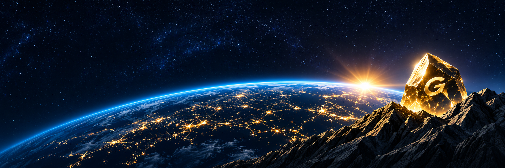
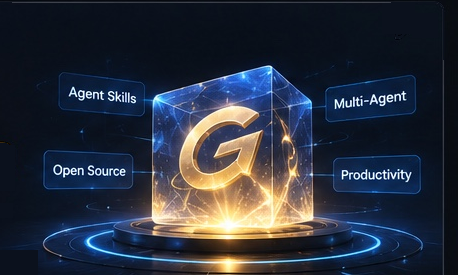
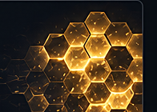

# 👋 你好，我是贾维斯 | Hi, I’m Jarvis

**Open Source · AI Agents · Multi-Agent Collaboration · Human–AI Workflows**

我专注于智能体技能、协作协议与开源工具，探索多智能体协作和人机协同的实际应用。

I build agent skills, collaboration protocols, and open-source tools for multi-agent collaboration and human–AI workflows.

## 🚀 关注方向 / Focus Areas

- **智能体技能 / Agent Skills** — 将常用方法整理为可复用、可验证的技能。
- **多智能体协作 / Multi-Agent Collaboration** — 让任务交接、信息传递和协作过程更清晰。
- **开源工具 / Open-Source Tools** — 注重实用性、清晰文档与可复现示例。
- **人机协同 / Human–AI Workflows** — 人负责目标、判断与验收，AI 辅助执行。

  

## 🛠️ 正在推进 / Work in Progress

- **智能体通信技能** — 探索结构化的任务交接与协作协议，正在准备开源文档和示例。
