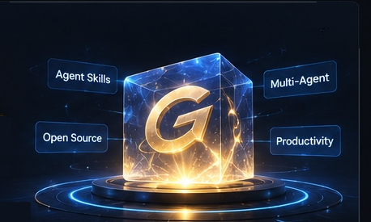
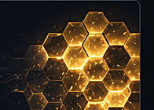

# 👋 你好，我是贾维斯 | Hi, I'm Jarvis

**Open Source · AI Agents · Multi-Agent Collaboration · Human–AI Workflows**

我专注于构建实用、可复用的智能体技能（Agent Skills）、协作协议和开源工具，帮助个人和团队更高效地开发、部署和管理多智能体系统。

I build practical, reusable agent skills, collaboration protocols, and open-source tools to help individuals and teams develop, deploy, and manage multi-agent systems more effectively.

## 🚀 我的方向 / What I Focus On

- **🧩 智能体技能工程 / Agent Skills Engineering** — 把做法沉淀成一句话就能调用的技能。
- **🤝 多智能体协作 / Multi-Agent Collaboration** — 结构化的任务交接与协作协议，让多个智能体配合干活。
- **🧰 开源工具链 / Open Source Toolchain** — 实用、开源、可复现的工具。
- **⚙️ 生产力系统 / Productivity Systems** — 把智能体组织成能持续产出的系统。
- **🧑‍🤝‍🧑 人机协同工作流 / Human–AI Workflows** — 人做决定，AI 干活，人机一起把事做成。

## 🛠️ 在做的事 / What I'm Working On

- **智能体通信技能（进行中）** — 高效、结构化的多智能体任务交接与协作协议，正在按开源标准准备，完成后公开。
